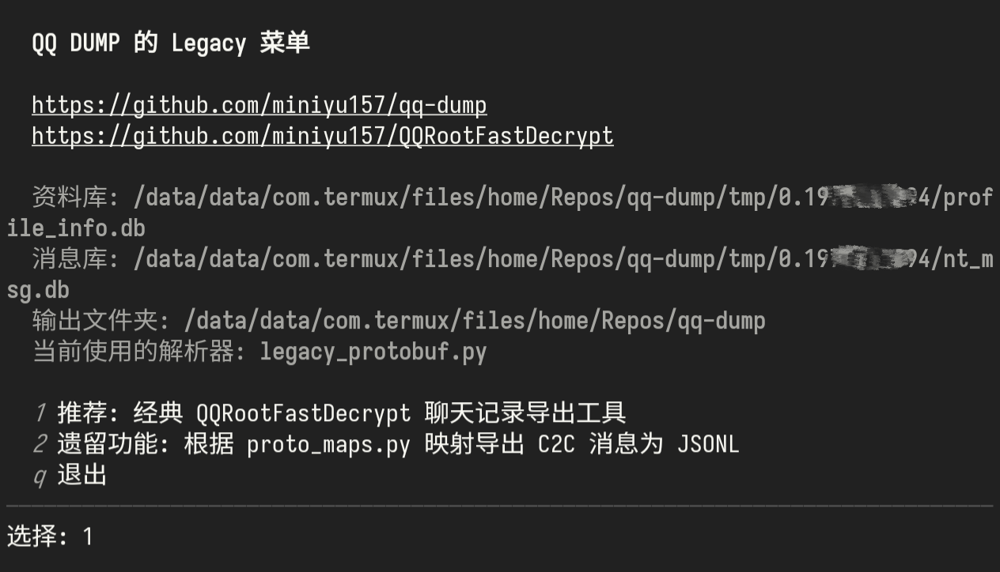
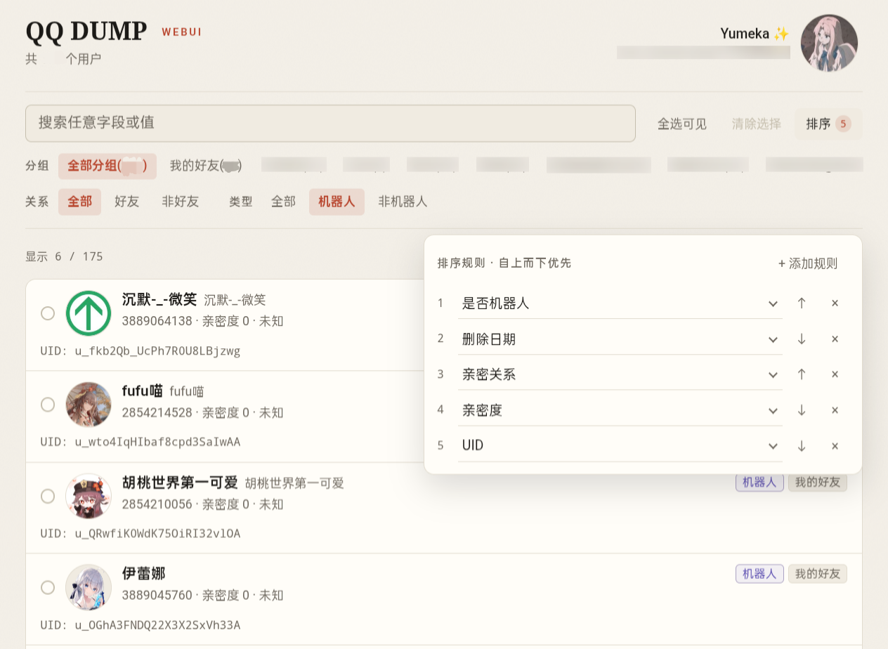

# QQ DUMP + Trowel !

⛏ 全方位友好的 QQNT 数据库转储、消息导出与统计、好友查询、WebUI，以及专为逆向与开发设计的数据库与消息研究分析套件。

> 项目已全面升级到 Python，其中的运行时依赖按需使用，均为非强制。  
> 主分支已重写历史记录，包含旧提交的分支在 *[dbtools 分支](https://github.com/miniyu157/qq-dump/tree/feat/dbtools)* 仍可查看。  
> 保留内嵌了经典消息导出项目 *[QQRootFastDecrypt](https://github.com/miniyu157/QQRootFastDecrypt)* 的完整代码，已适配此项目架构，可直接运行。

此文档编辑于 2026年10月31日 下午。  
<s>写文档好累呀 T^T</s>

---

## 截图预览

*无参数时进入的 TUI 交互界面:*


> 仿了 *[gum](https://github.com/charmbracelet/gum)* 的 choose。<s>好吧，我确实很喜欢。</s>

*终端界面与提示信息示例:*


> 图片中依赖列表已过时，已移除 blackboxprotobuf 的检查。

*Legacy 菜单示例:*



*目前的 WebUI 好友浏览界面示例:*



---

## TODO

> 目前的 WebUI 功能，仅为从数据库中解析详细的好友列表后，在前端显示漂亮界面渲染。

<details>
<summary>🐱 点击展开 TODO 计划</summary>

***TODO:***
- Legacy (QQRootFastDecrypt) 功能
  - [ ] 后续可能会完全被新的消息解析功能替代，但仍旧保留 Legacy 菜单。
  - 先让 legacy 代码看起来漂亮一点。
    - [x] 完成 **去 blackboxprotobuf 化** 使用仓库自带的轻量解析器。
    - [ ] 交互体验优化、性能优化等，可能为导出时选择的好友列表添加搜索功能等。
- 新的消息解析/导出/统计等:
  - [ ] 交互体验，使用精心设计的友好 TUI/WebUI 操作界面。
  - [ ] 实现更多的统计、群聊导出、艾特统计、年度/月度/天度报告等功能。
  - [ ] 各种各样的统计、花哨功能，甚至做出插件化。
  - [ ] 还原几乎全部的 protobuf 消息类型，最大程度上个性化导出。
  - [ ] 覆盖全数据库/全表，什么有价值就可以导出什么。
    - [ ] 还会支持 buddy/groups_msg_fts.db 等文本摘要数据库的导出与统计。
- [ ] **正在进行！** 将旧的 Table2D 研究分析套件 (CLI 的 50 个雷霆大参数，但其实很好用) 完全重写到 Trowel。


> 也许会使用 Trowel 解决所有难题，探索并覆盖全部消息类型的解析。  
> **是的，这个东西很漂亮。**

</details>

---

## 特性

***消息导出:***

目前如果要解析消息或导出聊天记录，仍非常推荐使用 Legacy (QQRootFastDecrypt) 功能。

Legacy 代码虽然较老，除了已做交互适配和适当优化之外，功能依旧相当完善，例如：

<details>
<summary>🦉 点击展开 Legacy (QQRootFastDecrypt) 功能特性介绍</summary>

*[原 QQRootFastDecrypt 仓库地址 (已归档)](https://github.com/miniyu157/QQRootFastDecrypt)*  
*[此项目嵌入的代码 (legacy-cli 文件夹)](https://github.com/miniyu157/qq-dump/tree/main/legacy-cli)*

- 支持导出文件为 TXT、MD、HTML模版，每一种格式的渲染器精心设计；  
- 交互时列出好友列表，通过菜单交互选择，也可以一键选择组；支持设置精确的时间范围；  
- 支持选择模式导出 (如 `导出合并的时间线单文件`/`导出每个好友单独的文件`)，  
- 支持非好友组的扫描与导出；  
- 支持设置用户标记 (如备注、昵称，UID，或者其它自定义模版)；  
- 覆盖的消息类型较为广泛，能够精确区分消息类型并应对不同的渲染，包括但不限于红包类型、图片类型(图片/闪照/商城表情/用户表情/QQ表情等)、多种Ark卡片的精确解析、戳一戳提示、撤回提示、系统灰条、引用消息等。  
- 可以精确控制内容显示开关，手动设置要导出什么类型的消息，也可以添加文件头摘要。  
- 内置一套 protobuf 损坏时，以上下文感知的补救措施。

</details>

**不止如此，Legacy 功能已改为使用仓库自带的快速 protobuf 解析器，并允许使用 `--blackboxprotobuf` 选项使用旧解析器。**

*Legacy 新旧解析器性能对比(仅供参考):*

```
样本: 399212 条，  
legacy_protobuf.py: 24.367353 秒，16383 条/秒；成功 399212，失败 0  
blackboxprotobuf: 120.413602 秒，3315 条/秒；成功 399212，失败 0  
耗时比 (blackboxprotobuf / legacy_protobuf.py): 4.94 倍
```

> 性能测试可以通过 `legacy` 子命令启动 Legacy 菜单，进入 `QQRootFastDecrypt` 后选择 ` 9. 新旧解析器耗时对比`。

***轻量解析:***

- 消息解析器不使用庞大的 `blackboxprotobuf` 库，也不使用 `google.protobuf`，仓库自带短小精炼的 Protobuf 解析器实现。

***数据库解密:***

- 可能解决了 sqlcipher 解密大于 1GiB 数据库时报 `database disk image is malformed` 的问题，  
  这会导致解密后的明文数据库不完整，具体是锁页上的细节。  
  不过有时仍可能会在写入明文数据库时出现此报错，具体源代码可以查看 [cli/decrypt_db.py](cli/decrypt_db.py) 了解。
- 支持 gpro_1-6_\*.db 数据库解密。
  使用了 [QQDecrypt](https://qqbackup.github.io/QQDecrypt/database/db_file_analysis/gpro/) 中记录的方法。

> 也就是所有数据库全都能正确解密了。

***安全性:***

- QQ 私有目录均为只读操作，不会以任何形式直接修改内容。
- 当无法访问 QQ 私有目录时才自动提权。
- 还可以通过设置程序配置、或 .env 文件，让每一次提权操作都显示日志。
- 不提权整个程序本身，所有提权操作都是 fork sudo 后运行独立的子程序，  
  它们需要访问 QQ 私有目录以获取所需要的密钥、数据库文件等信息，集中位于 cli/ 文件夹下，短小可审阅。
- 不实现 sudo，直接使用 PATH 里的 sudo。

***精心设计的交互逻辑:***

- 除了 Python 以外所有依赖均为可选，按需使用，不自动补全。  
- 当一个功能 (如 friends 好友查询、legacy 消息导出) 需要数据库但你没有提供文件时，会自动扫描账号并弹出账号选择界面，选择后会解密需要的文件到临时文件夹。
- 提供数据库文件的方式有很多种，如 `QQDUMP_*` 环境变量、`.env` 文件、CLI 选项 等，了解优先级等详细信息，可以运行 `help` 命令查看帮助信息。

***CLI 子命令概览:***

| 子命令 | 用途 |
|---|---|
| `key` | 为选定用户计算数据库密钥 |
| `db [files...]` | 为选定用户解密指定的数据库文件 |
| `web` | 启动本地 WebUI (目前仅为好友信息浏览，包括已删除好友、亲密度、分组、删除时间等) |
| `friends` | 输出好友列表 JSON |
| `owner` | 输出主人 (数据库持有者) 信息 JSON |
| `legacy` | 启动经典 Legacy 消息导出 |
| `check` | 检查运行时依赖状态 |
| `avatar <uin>` | 使用 QQ API 获取头像并在终端渲染，支持 chafa 与真彩色 ASCII |

---

## 运行环境

在 Android 设备上使用喜欢的终端应用，或者在标准 Linux PC 上运行。

程序需要时，会从 QQ 私有目录 `/data/user/*/com.tencent.mobileqq/` 读取信息。

如果你不能访问它，可以使用 `--root-dir` 选项，或 `QQDUMP_ROOT_DIR=...` 环境变量，或 `.env` 文件指定根目录。

这在 PC 上调试与开发尤为有用。

---

## 开始

确保电脑中有 Python，程序需要它运行。

**方式一: 下载仓库后运行:**

```bash
git clone https://github.com/miniyu157/qq-dump.git
./qqdump  # 或 ./main.py
```

仓库更新比较快的时候，可以用这个方式便捷地获取最新代码，运行以下命令即可更新:

```bash
git pull
```

*后续可能会有自动检查更新的功能。*

> 版本号使用 git 获取，形如 `v0.0.0-5-gaabbcc (2026-10-30)`，  
> 其中 `v0.0.0` 是最近的 Release 版本号，`-5` 是提交次数，后面的是提交 hash 和时间与日期。  
> 脏工作区会为版本号追加 `-dirty` 脏标记，不影响功能和运行。

**方式二: Release 稳定版源码包**

可前往 [Releases](https://github.com/miniyu157/qq-dump/releases) 页面，从需要的版本中，找到 *Assets* 下方的 *Source code (zip)* 或者 *Source code (tar.gz)* 链接，即可下载此应用的源码包。

源码包需要解压后运行，可能需要使用 `chmod +x` 命令为入口附加执行权限，也可以直接使用 `python3 ...` 运行。

> 源码包也会正确显示版本号，仓库设置了 .git_archival.txt 与 .gitattributes 文件。

---

## 数据库与二进制研究分析套件

*Table2D，通用的数据库与 protobuf 二进制分析工具*

> 这个 cli 竟然包含了 50 个雷霆大选项 QAQ，正重写并更名为 Trowel


> 一点点预览图，涉及群聊隐私的信息已打码。

---

## 贡献、议题、Bug 反馈

非常欢迎提交 PR 和开启 Issues。

<s>相关的贡献文档待编写与完善...</s>

---

## 开源许可证

采用 [MIT LICENSE](./LICENSE) 分发

---

## 免责声明

本项目仅供学习交流使用，严禁用于任何违反中国大陆法律法规、您所在地区法律法规、QQ软件许可及服务协议的行为，开发者不承担任何相关行为导致的直接或间接责任。

本项目不对生成内容的完整性、准确性作任何担保，生成的一切内容不可用于法律取证，您不应当将其用于学习与交流外的任何用途。
