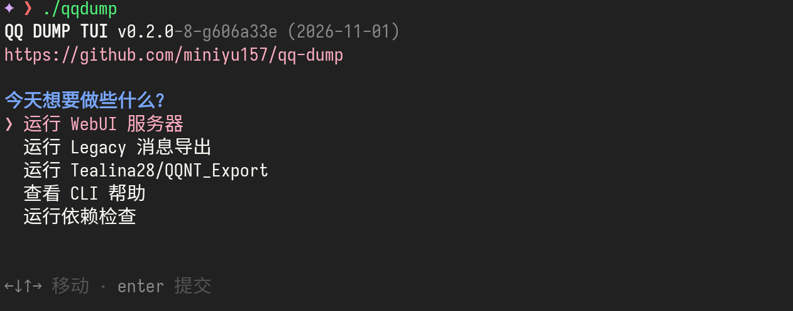
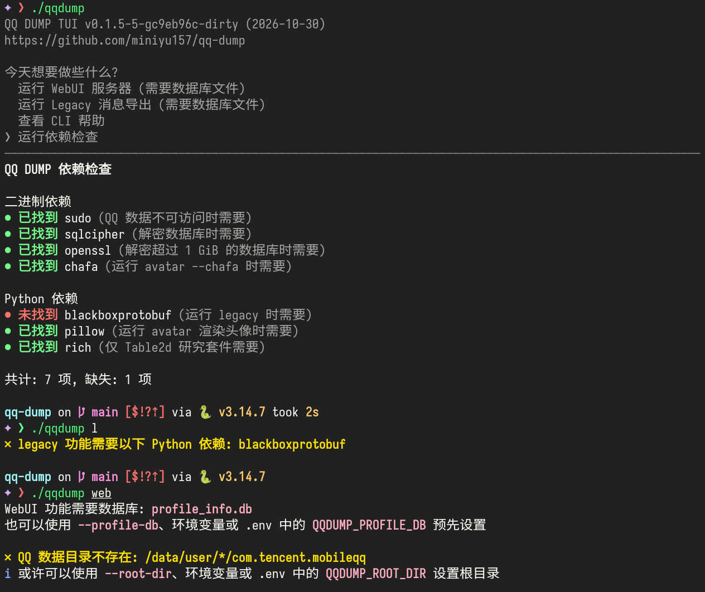
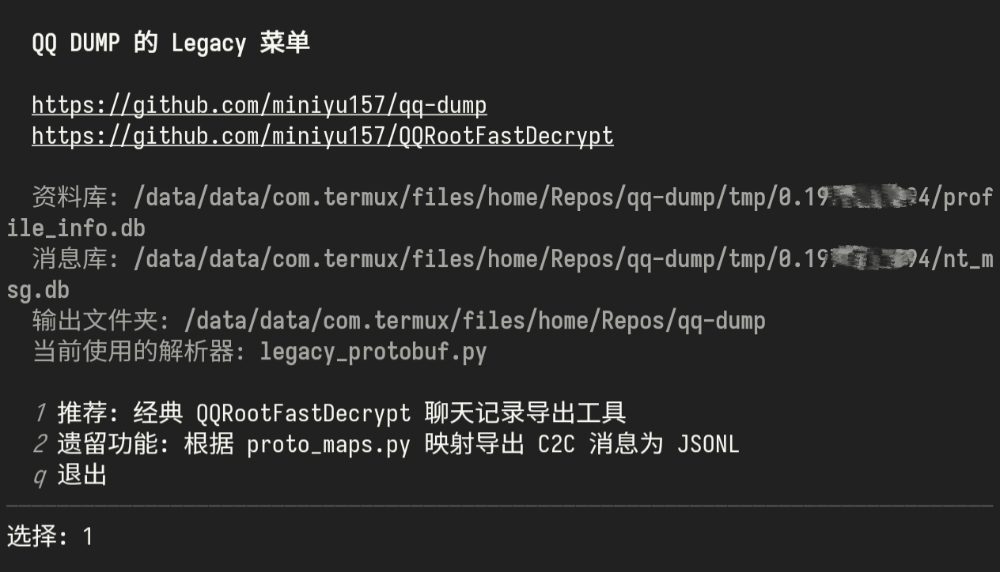
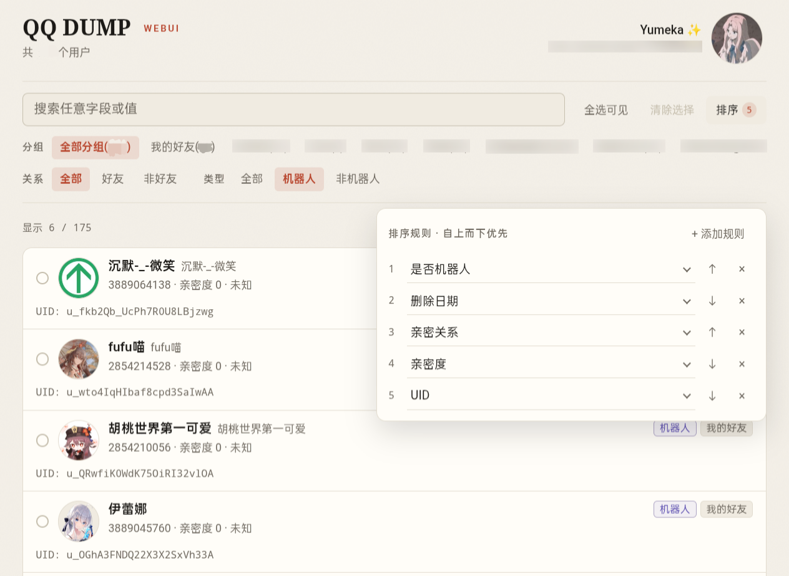
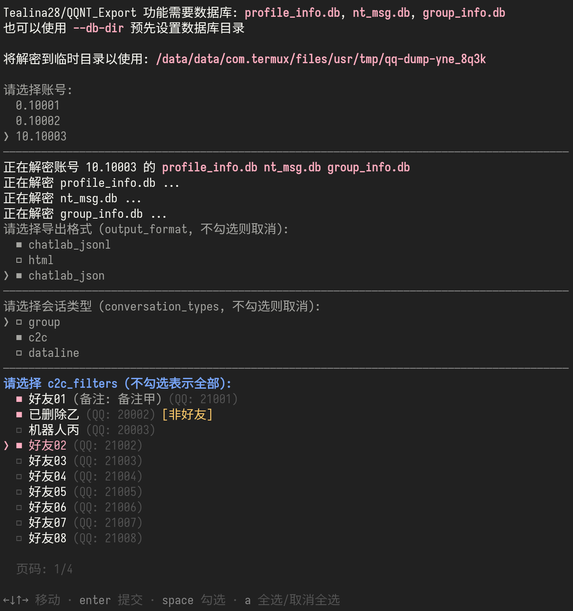
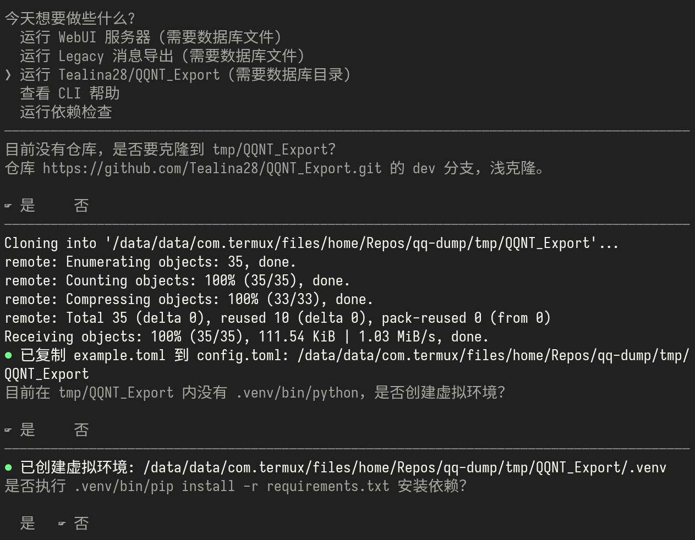
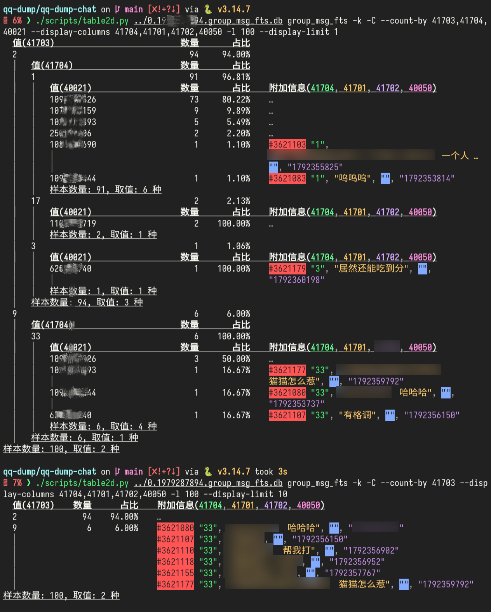

# QQ DUMP + Trowel !

⛏ 全方位友好的 QQNT 数据库到信息一站式流水线：涵盖数据库解密与转储、消息解析与导出、统计分析、好友查询及 WebUI，并提供专为逆向研究与开发设计的数据库和消息研究分析套件。

支持 Android、Windows、Linux。

> 项目已全面升级到 Python，其中的运行时依赖按需使用，均为非强制。  
> 主分支已重写历史记录，包含旧提交的经典 bash 实现在 *[dbtools 分支](https://github.com/miniyu157/qq-dump/tree/feat/dbtools)* 仍可查看。  

> 保留了经典消息导出项目 *[QQRootFastDecrypt](https://github.com/miniyu157/QQRootFastDecrypt)* 的完整代码，已适配此项目架构，可直接运行。

此文档编辑于 2026年11月13日 上午  
~~写文档真的好累呀 T^T~~

---

## 截图预览

> 截图已过时，待更新。

*无参数时进入的 TUI 交互界面:*



> 仿了 *[gum](https://github.com/charmbracelet/gum)* 的 choose。~~好吧，我确实很喜欢。~~

*终端界面与提示信息示例:*



> 图片中依赖列表已过时，已移除 blackboxprotobuf 的检查。

*Legacy 菜单示例:*



*目前的 WebUI 好友浏览界面示例:*



---

## 开始

在 Android 设备上使用喜欢的终端应用，或者在 Windows、Linux 上运行。确保设备中有 Python 3.11 及以上版本，程序需要它运行。

**方式一: 克隆仓库 (推荐):**

```bash
git clone https://github.com/miniyu157/qq-dump.git
cd qq-dump
./qqdump  # 或 ./main.py；Windows 的 PowerShell 与 cmd 中为 .\qqdump
```

启动器按以下顺序查找解释器，只负责启动，不检查依赖:

1. 环境变量 `QQDUMP_PYTHON` 指定的解释器，不可用时直接报错
2. 仓库内的 `.venv`
3. 系统 Python
4. `uv python find` 找到的解释器

运行时，依赖缺失时，程序会列出可用的补全方式: pip、uv、.venv，以及 Termux pkg 中的 python 包。  
缺少二进制依赖时，若为 Termux 环境，则询问是否安装。Termux 以外的平台则只提示名称。

仓库更新比较快的时候，可以用这个方式便捷地获取最新代码，运行以下命令即可更新:

```bash
git pull
```

> 版本号使用 git 获取，形如 `v0.0.0-5-gaabbcc (2026-10-30)`，  
> 其中 `v0.0.0` 是最近的 Release 版本号，`-5` 是提交次数，后面的是提交 hash 和时间与日期。  
> 脏工作区会为版本号追加 `-dirty` 脏标记，不影响功能和运行。

**方式二: Release 稳定版源码包:**

可前往 [Releases](https://github.com/miniyu157/qq-dump/releases) 页面，从需要的版本中，找到 *Assets* 下方的 *Source code (zip)* 或者 *Source code (tar.gz)* 链接，即可下载此应用的源码包。

源码包需要解压后运行，可能需要使用 `chmod +x` 命令为入口附加执行权限，也可以直接使用 `python3 ...` 运行。

> 源码包也会正确显示版本号，仓库设置了 .git_archival.txt 与 .gitattributes 文件。

---

## 特性

> *计划:*
> - [ ] 新的消息解析体系正在开发

> 目前的 WebUI 功能，仅为从数据库中解析详细的好友列表后，在前端显示漂亮界面渲染。


### *₊˚⊹ 消息导出*

目前推荐使用 Legacy (QQRootFastDecrypt) 功能。

Legacy 代码虽然较老，除了已做部分交互适配和适当优化之外，功能依旧相当完善，例如：

<details>
<summary>展开特性说明</summary>

- 支持导出文件为 TXT、MD、HTML模版，每一种格式的渲染器精心设计；  
- 交互时列出好友列表，通过菜单交互选择，也可以一键选择组；支持设置精确的时间范围；  
- 支持选择模式导出 (如 `导出合并的时间线单文件`/`导出每个好友单独的文件`)，  
- 支持非好友组的扫描与导出；  
- 支持设置用户标记 (如备注、昵称，UID，或者其它自定义模版)；  
- 覆盖的消息类型较为广泛，能够精确区分消息类型并应对不同的渲染，包括但不限于红包类型、图片类型(图片/闪照/商城表情/用户表情/QQ表情等)、多种Ark卡片的精确解析、戳一戳提示、撤回提示、系统灰条、引用消息等。  
- 可以精确控制内容显示开关，手动设置要导出什么类型的消息，也可以添加文件头摘要。  
- 内置一套 protobuf 损坏时，以上下文感知的补救措施。

</details>

不止如此，Legacy 功能已改为使用仓库自带的轻量级 protobuf 解析器，也允许使用 `--blackboxprotobuf` 选项使用旧解析器。

新解析器短小精炼，不依赖庞大的 `blackboxprotobuf` 库，也不使用 `google.protobuf`，速度是原来的 3-5 倍左右，对比测试与解析器差异详情可以查看 *Protobuf 解析器差异* ([点击跳转](#protobuf-parser-comparison)) 章节。

**Tealina28/QQNT_Export 接入:**

v0.5.0 起可以直接从主菜单运行 [↗ Tealina28/QQNT_Export](https://github.com/Tealina28/QQNT_Export)，这是一个解析 QQNT 数据库的 Github 仓库。

<details>
<summary>展开详情说明与截图预览</summary>

> [!NOTE]
> 没有嵌入或修改 QQNT_Export 的任何代码，只经过 qq-dump 预处理流程后，原地修改 toml 正常启动。

传统方案需要手动找库、解密、修改配置。该项目的配置入口是 `config.toml`，沿用 QQ DUMP 的账号选择、数据库解密与好友查询，把交互结果写回配置再启动它解析与导出，从数据库到导出一次走完。

选择结果原地写回 `config.toml`，这一步需要 QQ DUMP 自身安装 `tomlkit`。  

配置文件是持久的，每次都能读取上次保存的配置；若上游出现了新的配置在配置文件中，也不会直接覆盖，而是添加到列表中可选择。

> 首次运行检查 `tmp/QQNT_Export`，不存在时询问是否浅克隆上游 dev 分支。  
> `config.toml` 缺失时由 `example.toml` 自动复制生成；缺少虚拟环境时询问是否创建，创建后询问是否安装 `requirements.txt`。  
> QQ DUMP 不会自动安装外部项目的依赖。





</details>

### *₊˚⊹ 多平台*

- 支持 Android、Windows、Linux，密钥均能分平台自动获取、进入解密流程。
- Android 版 QQ 的密钥由数据库文件头算出，采用 [QQDecrypt · NTQQ(Android)](https://qqbackup.github.io/QQDecrypt/decrypt/extract/NTQQ%20(Android).html) 网站记录的方法。
- PC 版 QQ (Windows / Linux) 的密钥获取能力，即从运行中的 QQ NT 进程内存中扫描 raw_key 的逻辑，移植自 [↗ QQBackup/x_key_scanner](https://github.com/QQBackup/x_key_scanner)。  
  原版是一个注意力惊人的项目，性能快速的 rust 实现。本项目虽然是 Python 移植，说慢也不慢。
- Linux 能找到 linuxqq 版和 flatpak 版，同时安装时供选择。

Windows、Linux 首次取密钥时，需要打开 QQ 并登录要处理的账号。Windows 通常不需要管理员权限；Linux 无权读取进程内存时，会询问是否使用 sudo 重试。

程序自动查找 QQ 数据目录；数据不在默认位置时，可用 `--root-dir` 指定，默认目录与调试用法见 [调试](#调试) 章节。

### *₊˚⊹ 数据库完整性*

- 解决了 sqlcipher 解密超过 1 GiB 的数据库时报 `database disk image is malformed` 的问题。  
  此前这类大库在写入明文库后会丢失大部分数据，现在解密时在临时副本上迁移锁页，这一步需要 `openssl`。
- 一并读取数据库旁的 `-wal` 文件，QQ 尚未写回主文件的最近数据也会进入明文库。
- 导出成功后才替换输出文件，失败时保留原有输出，不会留下残缺的数据库。
- 支持 `gpro_v1-6_*.db` 数据库解密。  
  使用了 [QQDecrypt · gpro_v1-6_{nt_uid}.db](https://qqbackup.github.io/QQDecrypt/database/db_file_analysis/gpro/) 中记录的方法。

<details>
<summary>展开详情说明</summary>

> QQ 在数据库前附加了 1024 字节的明文文件头，SQLite 的锁区位于物理文件 1 GiB 处，因此 QQ 留空的是第 262144 页。  
  剥离文件头后，标准 SQLite 改认第 262145 页为锁页，而这一页存放着真实数据，读到即报错。  
  原理分析见 [QQBackup Discussion #92](https://github.com/orgs/QQBackup/discussions/92)。

> 需找到引用第 262145 页的父页，把该页移到留空的第 262144 页，改写父页中的指针并重新计算两页的 HMAC，再由 sqlcipher 导出为标准布局的明文库。  
  实现位于 [cli/decrypt_db.py](cli/decrypt_db.py)。

> 只支持锁页由内部页引用的情形，已知的真实样本均属于这种情形。  
  锁页为表或索引的根页、位于溢出链或被多处引用时，该数据库放弃导出并输出原因。

> 剥头副本与导出中的数据库放在输出目录下的隐藏临时目录，结束后删除。  
  解密时输出目录约需源库两倍的可用空间，复制前会检查能否放下临时副本。

> 读取的是复制时刻的 `-wal`。QQ 运行时仍在写入数据库，先结束 QQ 再复制或解密，才能得到一致的数据。

</details>

### *₊˚⊹ 安全性*

- QQ 私有目录均为只读操作，不会以任何形式直接修改内容；读取 Windows、Linux 版 QQ 的进程内存同样只读。
- 处理 Android 版 QQ 时，无法访问 QQ 私有目录才尝试自动提权。
- 处理 Windows、Linux 版 QQ 时，不会因为数据目录无法访问而提权，此时直接报错。Linux 下无权扫描 QQ 进程内存时，才在询问并得到同意后提权取密钥。
- 还可以用 `--sudo-notice` 选项、`QQDUMP_SUDO_NOTICE` 环境变量或 .env 文件，让每一次提权操作都显示日志。
- Windows、Linux 的密钥以明文保存，默认位于仓库下的 `.cache/keys.json`，需妥善保管。持有缓存和对应的加密数据库即可解密；删除缓存后，下次使用会重新取密钥。
- 不提权整个程序本身，所有提权操作都是 fork sudo 后运行独立的子程序，  
  它们需要访问 QQ 私有目录或进程内存以获取所需要的密钥、数据库文件等信息，集中位于 cli/ 文件夹下，短小可审阅。
- 不实现 sudo，直接使用 PATH 里的 sudo。

### *₊˚⊹ 精心设计的交互逻辑*

- 除了 Python 解释器本身以外，所有依赖均为可选，按需使用；缺少时在交互终端询问补全方式，非交互时给出命令。  
- 当一个功能 (如 friends 好友查询、legacy 消息导出) 需要数据库但你没有提供文件时，会自动扫描账号并弹出账号选择界面，选择后会解密需要的文件到临时文件夹。
- 提供数据库文件的方式有很多种，如 `QQDUMP_*` 环境变量、`.env` 文件、CLI 选项 等，了解优先级等详细信息，可以运行 `help` 命令查看帮助信息。
- 处理 Windows、Linux 版 QQ 数据时，程序会缓存取得的密钥供下次复用，避免反复登录 QQ、读取进程内存和提权。
- CLI 不敷衍，管道数据进出分明，帮助信息与子命令用法完整。

### *₊˚⊹ CLI 子命令概览*

> 此章节待重新设计。

| 子命令 | 用途 |
| --- | --- |
| `key` | 为选定账号取得数据库密钥，输出 JSON |
| `db [files...]` | 为选定账号解密指定的数据库文件 |
| `web` | 启动本地 WebUI (目前仅为好友信息浏览，包括已删除好友、亲密度、分组、删除时间等) |
| `friends` | 输出好友列表 JSON |
| `owner` | 输出主人 (数据库持有者) 信息 JSON |
| `legacy` | 启动经典 Legacy 消息导出 |
| `t28` | 启动 Tealina28/QQNT_Export 导出 |
| `check` | 检查运行时依赖状态 |
| `avatar <uin>` | 使用 QQ API 获取头像并在终端渲染，支持 chafa 与真彩色 ASCII |
| `menu` | 显示主菜单，不带子命令时默认进入 |
| `help` | 显示完整帮助，包括全部选项与环境变量 |

---

<span id="protobuf-parser-comparison"></span>

## Protobuf 解析器差异

**Legacy 新旧解析器性能对比(仅供参考):**

每个解析器各运行一次，不计数据库读取、导入及渲染耗时。

样本: 399212 条。

| 解析器 | 耗时 | 吞吐量 | 成功 | 失败 |
| --- | ---: | ---: | ---: | ---: |
| `legacy_protobuf.py` | 24.367353 秒 | 16383 条/秒 | 399212 | 0 |
| `blackboxprotobuf` | 120.413602 秒 | 3315 条/秒 | 399212 | 0 |

旧除以新解析器的耗时比: **4.94 倍**。

> 性能测试可以通过 `legacy` 子命令启动 Legacy 菜单，进入 `QQRootFastDecrypt` 后选择 `9. 新旧解析器耗时对比`。

**Legacy 新旧解析器实机导出耗时对比 (仅供参考):**

| 解析器 | 导出有效消息数 | 本次用时 |
| --- | ---: | ---: |
| `legacy_protobuf.py` | 388581 | 25.773079 秒 |
| `blackboxprotobuf` | 388581 | 111.951331 秒 |

旧除以新解析器的耗时比: **4.34 倍**，此处统计完整导出流程，与上方仅统计解码的性能测试不同。结果会受设备性能、文件系统缓存和消息内容影响。

> 以 `v0.4.0-1 (960022f)` 为准，以 TXT 格式导出“合并时间线单文件-全部好友”，未开启文件头和数据库 hash 计算，未开启非好友/临时会话的线性扫描。

> 计时从完成时间范围输入后开始，包含数据库查询与结果加载、第一遍解码过滤、第二遍解码与文本格式化，直到文件写入并关闭，不包含启动加载和菜单等待时间。

**新旧解析器下的 Legacy 经典导出差异:**

新解析器按已知字段展开消息结构，保留文本原始字节，而不是交给 `blackboxprotobuf` 自动推断嵌套结构，避免将文本误判为嵌套消息。减少解析异常后仅输出零散文本、内部标识或资源路径的情况。

样本 **388581 条** 导出记录中，**148 条存在差异，其余完全一致**。其中 74 条恢复了引用结构，27 条恢复了语音、图片或文件标记，共 101 条不再仅显示 UID、资源字符串或不完整的内容片段。其他变化主要涉及文本符号与空白的保留、引用原文更新，以及撤回者名称和 QQ 表情的补全。

此外，样本中还体现出两类语义处理问题: **2 条原消息** 由 `[闪传]` 变为 `[Markdown]`，并影响了 **3 条后续引用**，这些引用已计入上述引用原文变化。该类型标记来自 QQRootFastDecrypt 原有的映射，更换解析器并未补全闪传支持。另有 **1 条图片尺寸** 因新解析器按无符号整数读取，将 `-1` 显示为大整数，仍需按字段语义处理。这两类问题直接涉及 3 条记录，包含引用传播共涉及 6 条，不能视为内容恢复的改善。

---

## 数据库与二进制研究分析套件

*Table2D，通用的数据库与 protobuf 二进制分析工具*

> 这个 cli 竟然包含了 50 个雷霆大选项 QAQ，正重写并更名为 Trowel



> 一点点预览图，涉及群聊隐私的信息已打码。

---

## TODO

> 目前的 WebUI 功能，仅为从数据库中解析详细的好友列表后，在前端显示漂亮界面渲染。

<details>
<summary>🐱 点击展开 TODO 计划</summary>

- Legacy (QQRootFastDecrypt) 功能
  - [ ] 后续可能会完全被新的消息解析功能替代，但仍旧保留 Legacy 菜单。
  - [x] 完成 **去 blackboxprotobuf 化** 使用仓库自带的轻量解析器。
  - [ ] 交互体验优化、性能优化等，可能为导出时选择的好友列表添加搜索功能等。
- 新的消息解析体系:
  - [ ] 精心设计的友好 WebUI 操作界面。
  - [ ] 实现更多的统计、群聊导出、艾特统计、年度/月度/天度报告等功能。
        各种各样的统计、花哨功能，甚至做出插件化。
  - [ ] 还原几乎全部的 protobuf 消息类型，最大程度上个性化导出。
  - [ ] 覆盖全数据库/全表，什么有价值就可以导出什么。
    - [ ] 还会支持 buddy/groups_msg_fts.db 等文本摘要数据库的导出与统计。
- [ ] **正在进行！** 将旧的 Table2D 研究分析套件 (CLI 的 50 个雷霆大参数，但其实很好用) 完全重写到 Trowel。

</details>

---

## 调试

### 数据目录

`--root-dir` (`-r`) 指定数据根目录，各平台的默认位置与目录格式如下。第三列为根目录下的相对路径。程序按目录结构识别平台，也可用 `--platform` (`-P`) 显式指定。

| 平台 | 默认数据根目录 | 根目录下的结构 |
| --- | --- | --- |
| `android` | `/` | `data/user/<Android 用户 ID>/com.tencent.mobileqq/` |
| `windows` | QQ 配置指向的 *Tencent Files* | `<QQ 号>/nt_qq/nt_db/` |
| `linux` | `~/.config/QQ`，flatpak 为 `~/.var/app/com.qq.QQ/config/QQ` | `nt_qq_<哈希>/nt_db/` |

平台指数据来自哪个系统的 QQ，与运行本程序的系统无关。处理 Windows、Linux 的离线数据时，用 `--key-cache` (`-k`) 指定与数据匹配的密钥缓存; `key` 的 JSON 输出也可直接作为缓存。

### 调试入口

主程序的 `-v/--verbose` 显示详细信息，`-E/--ignore-env` 忽略 `QQDUMP_*` 环境配置与仓库 `.env`。解析问题可通过 `-p/--profile-db`、`-n/--nt-msg-db` 直接提供明文库复现。

取密钥与解密工具可以独立运行，均支持 `-v` 和 `--help`:

| 工具 | 用途 |
| --- | --- |
| `cli/get_keys.py` | 定位账号、取得密钥; `--locate` 只输出平台与数据根目录候选 |
| `cli/decrypt_db.py` | 使用指定密钥解密数据库 |

`test/make_root.py` 可生成 Android 布局的合成数据，需要 `sqlcipher`，输出到 `test/root/`，目录已存在时拒绝运行。样本包含正常与故障数据，用于手动测试。

---

## 贡献、议题、Bug 反馈

非常欢迎提交 PR 和开启 Issues。

~~相关的贡献文档待编写与完善...~~

---

## 开源许可证

采用 [MIT LICENSE](./LICENSE) 分发

---

## 移植与来源

PC 版 QQ (Windows / Linux) 的密钥获取能力，即从运行中的 QQ NT 进程内存中扫描 raw_key 的逻辑，移植自 [↗ QQBackup/x_key_scanner](https://github.com/QQBackup/x_key_scanner) (Rust 实现)。

本项目以纯 Python 重新实现了其核心部分，不依赖原项目的二进制，也不依赖 `sqlcipher` 即可取得密钥：

- 进程枚举与内存读取 (Windows 经 `kernel32`、Linux 经 `process_vm_readv`，均用 `ctypes`)；
- 锚点与密集簇的候选扫描、排序；
- 账号与数据目录定位，以及 `login.db` 的解析。

原项目未附带开源许可证，本项目仅移植其算法与流程，未直接包含其源码。在此致谢原作者的分析与实现。

---

## 免责声明

本项目仅供学习交流使用，严禁用于任何违反中国大陆法律法规、您所在地区法律法规、QQ软件许可及服务协议的行为，开发者不承担任何相关行为导致的直接或间接责任。

本项目不对生成内容的完整性、准确性作任何担保，生成的一切内容不可用于法律取证，您不应当将其用于学习与交流外的任何用途。
