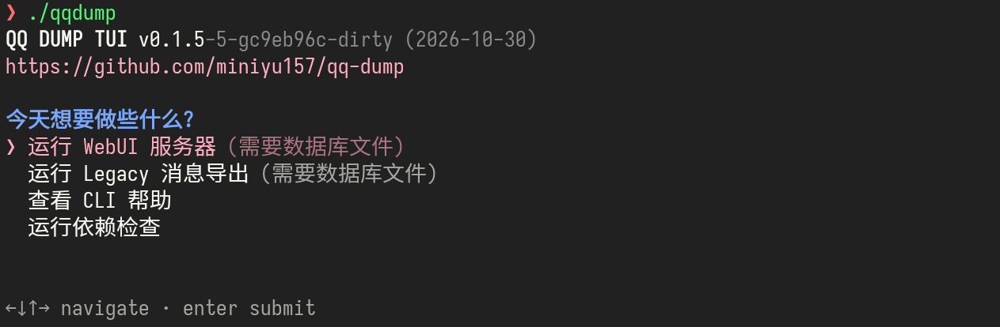
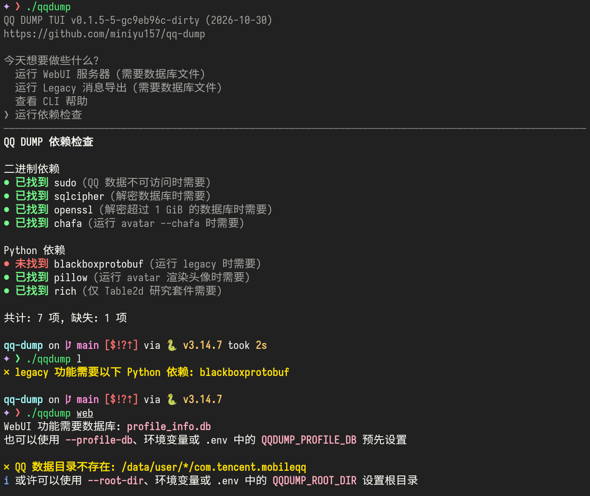
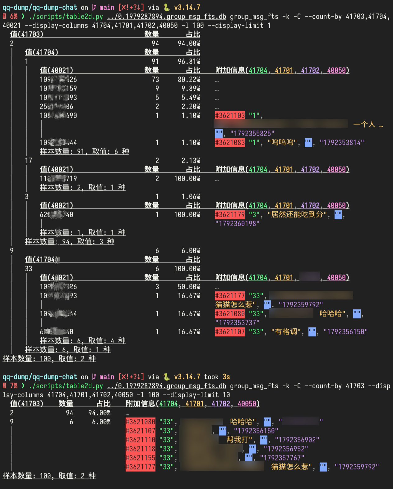

# QQ DUMP + Trowel !

⛏ 全方位友好的 QQNT 数据库转储、消息导出与统计、好友查询、WebUI，以及专为逆向与开发设计的数据库与消息研究分析套件。

> 项目已全面升级到 Python，其中的运行时依赖按需使用，均为非强制。  
> 主分支已重写历史记录，包含旧提交的分支在 *[dbtools 分支](https://github.com/miniyu157/qq-dump/tree/feat/dbtools)* 仍可查看。  
> 保留了经典消息导出项目 *[QQRootFastDecrypt](https://github.com/miniyu157/QQRootFastDecrypt)* 的完整代码，已适配此项目架构，可直接运行。

此文档编辑于 2026年10月30日 下午。  
<s>写文档好累呀 T^T</s>

---

## 截图预览

*无参数时进入的 TUI 交互界面:*



> 仿了 *[gum](https://github.com/charmbracelet/gum)* 的 choose。<s>好吧，我确实很喜欢。</s>

*终端界面与提示信息示例:*



---

## 特性

<details>
<summary>点击展开 TODO 计划</summary>

***TODO:***
- [ ] Legacy 后续可能会完全被新的消息解析功能替代，  
  新的消息解析体验使用精心设计的友好 TUI/WebUI 操作界面，并实现更多的统计、群聊导出、艾特统计、年度/月度/天度报告等功能。  
  还原几乎全部的 protobuf 消息类型，最大程度上设置如何渲染与导出。
- [ ] 还会支持 buddy/groups_msg_fts.db 等文本摘要数据库的导出与统计。
- [ ] 将旧的 Table2D 研究分析套件 (CLI 的 50 个雷霆大参数，各种语义歧义和不一致) 完全重写到 Trowel。

</details>

> 目前的 WebUI 功能，仅为从数据库中解析好友列表后渲染。  
> 目前如果要解析消息，仍推荐使用 Legacy 功能。

***轻量解析:***

- 新的消息解析不使用庞大的 blackboxprotobuf 库，仓库自带短小精悍的 Protobuf 解析器实现。
- 经典 Legacy 功能仍会使用 blackboxprotobuf 库解析消息，主程序不强制依赖。

***数据库解密:***

- 可能解决了 sqlcipher 解密大于 1GiB 数据库时报 `database disk image is malformed` 的问题，  
  这会导致解密后的明文数据库不完整，具体是锁页上的细节。  
  不过有时仍可能会在写入明文数据库时出现此报错，具体源代码可以查看 [cli/decrypt_db.py](cli/decrypt_db.py) 了解。
- 支持 gpro_1-6_\*.db 数据库解密。
  使用了 [QQDecrypt](https://qqbackup.github.io/QQDecrypt/database/db_file_analysis/gpro/) 中记录的方法。

> 也就是所有数据库全都能正确解密了。

***安全性:***

- QQ 私有目录均为只读操作，不会以任何形式直接修改内容。
- 当无法访问 QQ 私有目录时才自动提权。
- 还可以通过设置程序配置、或 .env 文件，让每一次提权操作都显示日志。
- 不提权整个程序本身，所有提权操作都是 fork sudo 后运行独立的子程序，  
  它们需要访问 QQ 私有目录以获取所需要的密钥、数据库文件等信息，集中位于 cli/ 文件夹下，短小可审阅。
- 不实现 sudo，直接使用 PATH 里的 sudo。

***精心设计的交互逻辑:***

- 除了 Python 以外所有依赖均为可选，按需使用，不自动补全。  
- 当一个功能 (如 friends 好友查询、legacy 消息导出) 需要数据库但你没有提供文件时，会自动扫描账号并弹出账号选择界面，选择后会解密需要的文件到临时文件夹。
- 提供数据库文件的方式有很多种，如 `QQDUMP_*` 环境变量、`.env` 文件、CLI 选项 等，了解优先级等详细信息，可以运行 `help` 命令查看帮助信息。

***CLI 子命令概览:***

| 子命令 | 用途 |
|---|---|
| `key` | 为选定用户计算数据库密钥 |
| `db [files...]` | 为选定用户解密指定的数据库文件 |
| `web` | 启动本地 WebUI (目前仅为好友信息浏览，包括已删除好友、亲密度、分组、删除时间等) |
| `friends` | 输出好友列表 JSON |
| `owner` | 输出主人 (数据库持有者) 信息 |
| `legacy` | 启动经典 Legacy 消息导出 |
| `check` | 检查运行时依赖状态 |
| `avatar <uin>` | 使用 QQ API 获取头像并在终端渲染，支持 chafa 与真彩色 ASCII |

---

## 运行环境

在 Android 设备上使用喜欢的终端应用，或者在标准 Linux PC 上运行。

程序需要时，会从 QQ 私有目录 `/data/user/*/com.tencent.mobileqq/` 读取信息。

如果你不能访问它，可以使用 `--root-dir` 选项，或 `QQDUMP_ROOT_DIR=...` 环境变量，或 `.env` 文件指定根目录。

这在 PC 上调试与开发尤为有用。

---

## 开始

确保电脑中有 Python，程序需要它运行。

**方式一: 下载仓库后运行:**

```bash
git clone https://github.com/miniyu157/qq-dump.git
./qqdump  # 或 ./main.py
```

仓库更新比较快的时候，可以用这个方式便捷地获取最新代码，运行以下命令即可更新:

```bash
git pull
```

*后续可能会有自动检查更新的功能。*

> 版本号使用 git 获取，形如 `v0.0.0-5-gaabbcc (2026-10-30)`，  
> 其中 `v0.0.0` 是最近的 Release 版本号，`-5` 是提交次数，后面的是提交 hash 和时间与日期。  
> 脏工作区会为版本号追加 `-dirty` 脏标记，不影响功能和运行。

**方式二: Release 稳定版源码包**

可前往 [Releases](https://github.com/miniyu157/qq-dump/releases) 页面，从需要的版本中，找到 *Assets* 下方的 *Source code (zip)* 或者 *Source code (tar.gz)* 链接，即可下载此应用的源码包。

源码包需要解压后运行，可能需要使用 `chmod +x` 命令为入口附加执行权限，也可以直接使用 `python3 ...` 运行。

> 源码包也会正确显示版本号，仓库设置了 .git_archival.txt 与 .gitattributes 文件。

---

## 数据库与二进制研究分析套件

*Table2D，通用的数据库与 protobuf 二进制分析工具*

> 这个 cli 竟然包含了 50 个雷霆大选项 QAQ，正重写并更名为 Trowel



> 一点点预览图，涉及群聊隐私的信息已打码。

---

## 贡献、议题、Bug 反馈

非常欢迎提交 PR 和开启 Issues。

<s>相关的贡献文档待编写与完善...</s>

---

## 开源许可证

采用 [MIT LICENSE](./LICENSE) 分发
